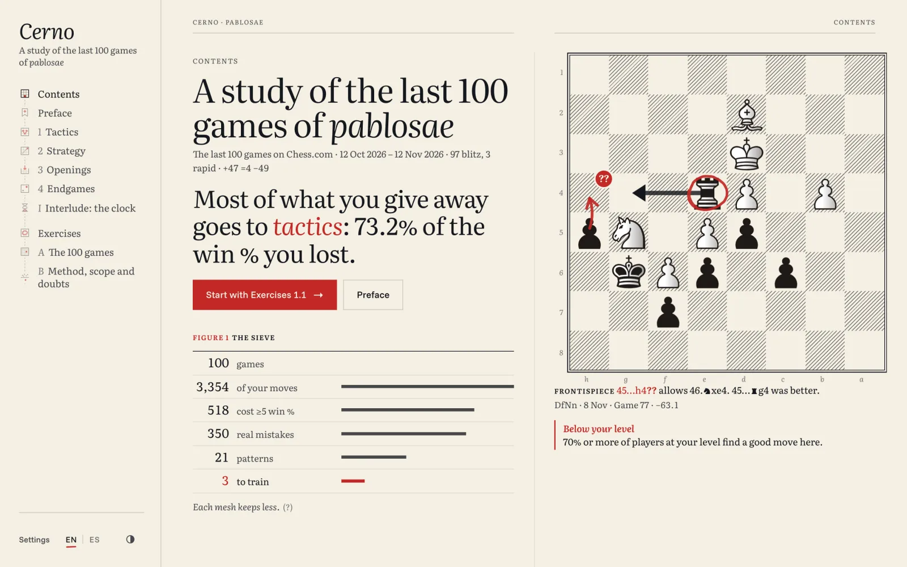
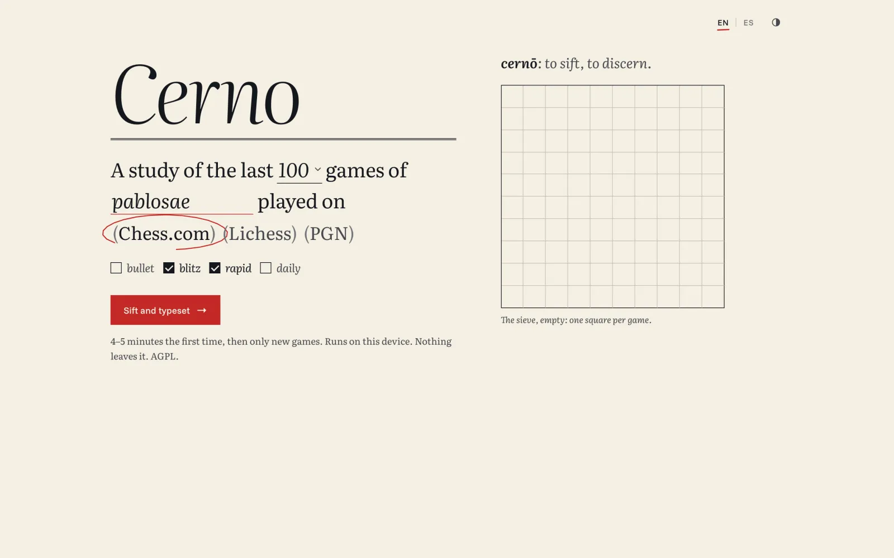
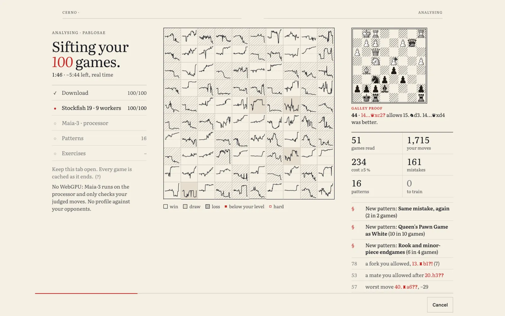
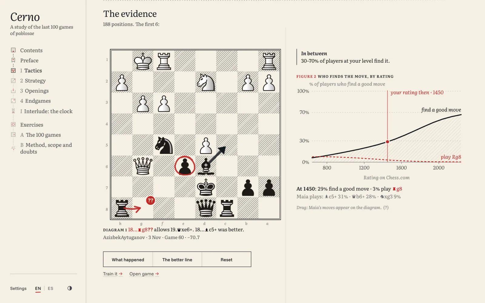
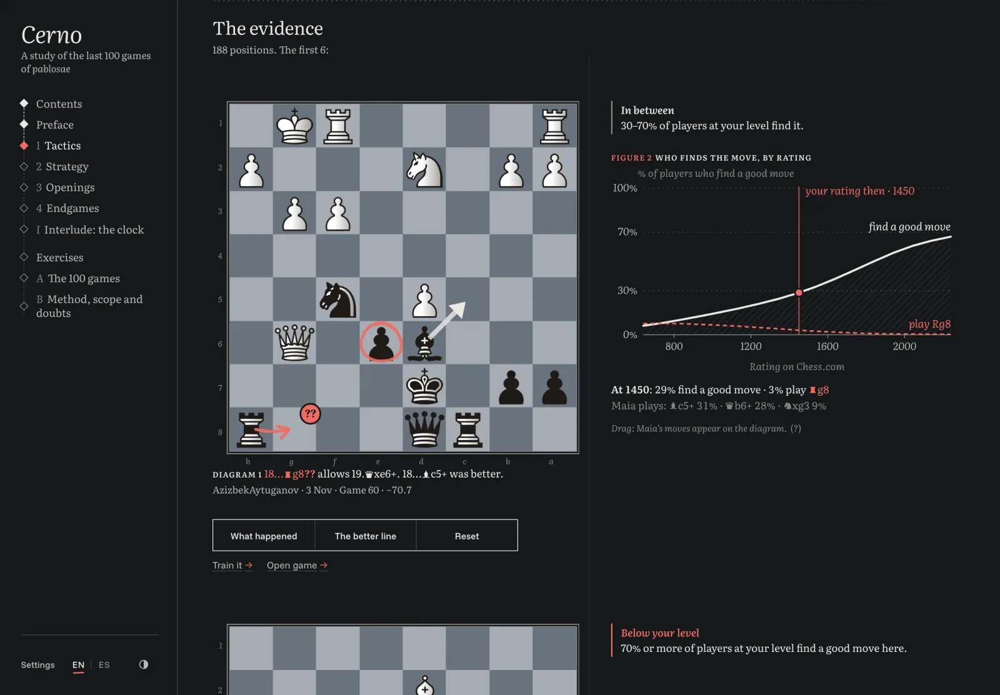
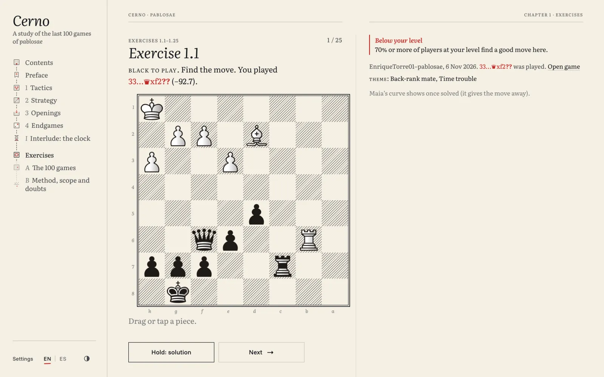
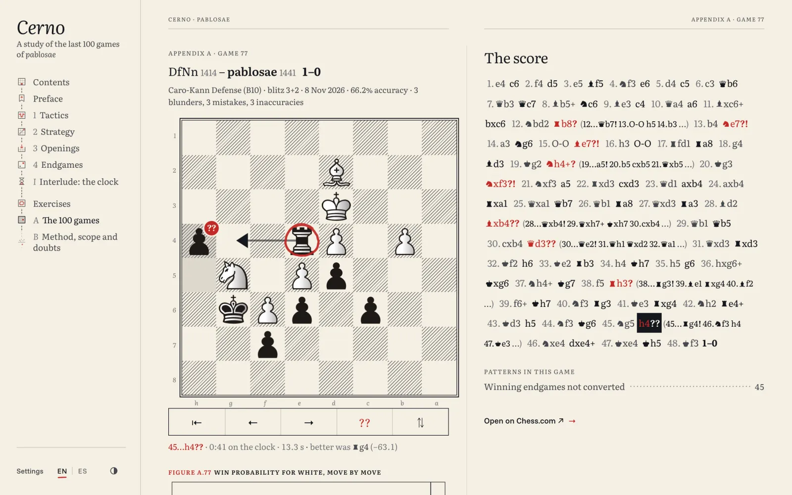
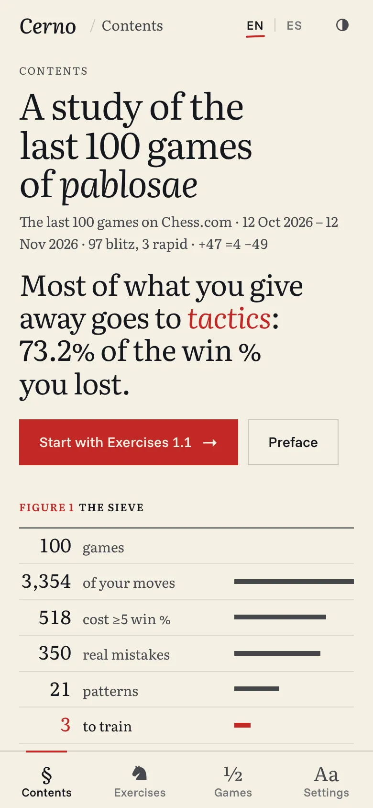
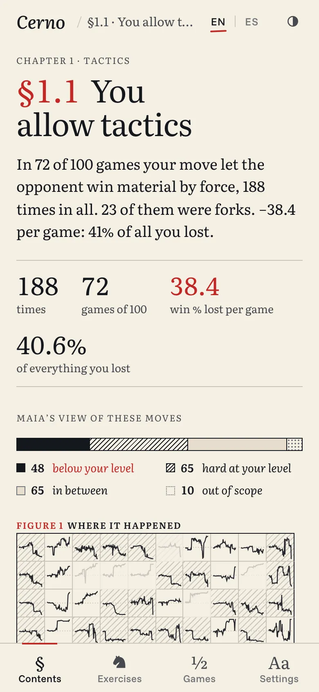

# Cerno

Cerno finds a chess player's weaknesses in their recent games: tactics, openings, endgames, strategy and the clock. Every conclusion links to the positions behind it, and the training recommendations come from fixed rules, not from a language model. It all runs in the browser, with no backend.



| | |
|---|---|
|  |  |
| Pick the player, the source and how many games. | One square per game. Its win % curve appears once Stockfish has read it. |
|  |  |
| A finding: each position with the mistake in red pencil, and how many players of each rating find a good move there (Maia-3). | The same page in the night theme. |
|  |  |
| Exercises come from the player's own mistakes. | Every game, move by move, with the engine's verdicts. |
|  |  |

## Run it

```bash
npm install
npm run dev        # http://localhost:3000
```

`/` is the app, typeset as an annotated chess book: contents, one chapter per area, the chapter against your opponents, exercises, the games and the method. Its scripts and styles are plain files in `public/folio/`. `src/folio/host.ts` loads them, runs the analysis and saves the last study in IndexedDB. `src/core/folio-data.ts` turns the report into the data the interface reads and computes Maia's Elo ladder (17 ratings) for the positions it shows.

`/lab` is a debug page with the raw report and timings. `/review` shows 30 random errors from the last lab report so a player can mark whether each label is right.

Static build: `npm run build` writes `out/`, and `node scripts/serve-out.mjs` serves it.

## How it works

Games come from the public Chess.com and Lichess APIs or from a PGN file. Stockfish 19 (WASM, lite net) runs in Web Workers, Maia-3 (5M, ONNX) runs in its own worker with onnxruntime-web, and results are cached in IndexedDB.

1. Fetch the last N games (`src/core/sources.ts`).
2. Pass 1 searches every position once at 60k nodes. Pass 2 searches the player's moves that lose win probability at 500k nodes with MultiPV 2, before and after the move (`src/core/analyze.ts`).
3. Judge each move by the win probability it loses, with the Lichess formula and thresholds (`src/core/winprob.ts`). Find its phase (`src/core/phase.ts`) and tactical evidence (`src/core/tactics.ts`), and give it one category (`src/core/classify.ts`).
4. Compare the player with their opponents in the same games (`src/core/peer-analysis.ts`, `peers.ts`, `peer-stats.ts`, `profile.ts`, `style.ts`, `repertoire.ts`). Maia-3 models Lichess blitz players at five Elo levels, and Stockfish rates each candidate move. A weakness is a kind of position where the player's moves are worse than their opponents', after adjusting both for how hard the positions were. Each one has an interval and a grade (confirmed, suggestive, within noise), from a game bootstrap with Benjamini-Hochberg. The report adds style traits, recurring opening leaks with what stronger players choose there, and per-error numbers such as how often players 200 Elo higher find a good move. With WebGPU, Maia runs on the GPU while Stockfish runs on the CPU.
5. Build the report: category stats, findings with evidence, three recommendations and exercises (`src/core/report.ts`). The contract is in [REPORT.md](REPORT.md).

The Maia-3 model is not in git. `npm run build` downloads `maia3-5m.onnx` (21 MB) from this repo's `maia3-onnx-v1` release and checks its SHA-256. `scripts/maia/export.py` rebuilds it from the official weights.

Measured on an Apple M5 (10 cores, 9 Stockfish workers, Maia on WebGPU), Chromium, empty cache: 100 blitz games with the full peer profile take 4 min 44 s, and the base report is ready at 2 min 49 s. A second run of the same games comes from the cache.

Validation (measured, see REPORT.md): synthetic players with planted weaknesses (unbiased; 6.7% of null players get any discovery; power 0.87 for a -200 Elo middlegame gap), 16 external Lichess players (the overall gap correlates 0.38 with results beyond rating), and a holdout of the reference player's older games. `scripts/peers/` reproduces each one.

## Checks

```bash
npm test           # unit tests, no network
npm run typecheck
npm run lint
npx tsx scripts/bench.ts <chesscom-games.json> <user> [workers] [pass1Nodes] [pass2Nodes]
node scripts/measure-browser.mjs <chesscom-user> [games]   # needs the static server running
```

## License

AGPL-3.0-or-later. It ships Stockfish (GPLv3) and the Maia-3 model (AGPLv3). Opening names: [lichess-org/chess-openings](https://github.com/lichess-org/chess-openings) (CC0).
